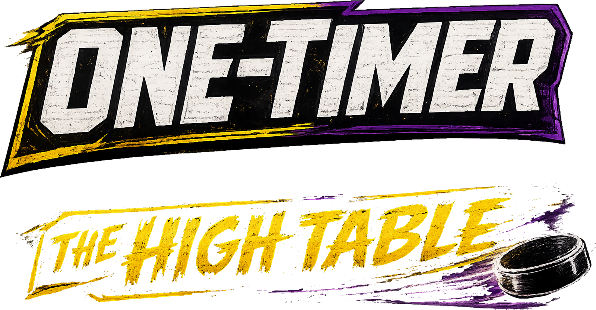

## ▶ [PLAY IT IN YOUR BROWSER][play]

*Just like Old-Tymes.*

Breakaway-speed air hockey, side-on or from overhead. Take the Throne as the
**Valley Queens** or win one for the Hivemind as the **Cohasset Bees**, at the
RIVALRY TABLE, the HONEY HOLE, the THRONE ROOM, or the HIGH TABLE itself —
Penalty Box Nachos, the turbo apex, where the game runs fastest.

Free, in your browser, nothing to install.

## How to play

Your knocker is the near one. Put the puck in the far goal.

**TRAP** catches the puck and winds up a shot for as long as you hold it.
**BLAST** lunges forward: it fires a trapped puck, or flattens the other
knocker. **GET BIG** lights up when your meter is full — your knocker grows for
a few seconds.

### On a phone

Turn it sideways.

- Steer with one thumb: drag anywhere on the table.
- The other thumb works the buttons, stacked top to bottom: **TRAP**,
  **GET BIG**, **BLAST**. The rings show your meter and BLAST's cooldown.
- Left-handed? Tap ❚❚, then turn on **BUTTONS ON THE RIGHT**.
- Prefer a stick? Tap **STICK** in the top corner for an 8-way thumbstick. The
  stick and the buttons take a side each.
- In Safari, tap Share, then **Add to Home Screen**. It opens full-screen like
  an app, and after your first game it plays offline.

### On a computer

- Steer with the mouse, WASD or the arrow keys.
- **TRAP**: hold the mouse button or **Z** · **GET BIG**: **X** · **BLAST**: **C**
- **P** or **Esc** pauses. **M** switches colour / black-and-white.

### With a controller

Set the pad to X-input (on an 8BitDo, also set the lever to D-pad). Press
**START**, then turn on **STICK** in the pause menu.

**A** TRAP · **B** GET BIG · **RT** BLAST · **START** pause

## Ways to play

- [HYSCORE][play] — the house cab at HYSCORE, the arcade off the 101. A
  quarter-eater: it runs its attract until you drop a quarter, then you play it
  out and run it back or walk.
- [CAMPAIGN][camp] — the Old-Tyme climb. Win a best-of-seven on each table to
  reach the next, all the way up to the High Table.
- [CASTLE RULES][castle] — three timed periods. Most goals at the horn wins; a
  tie goes to sudden-death overtime.
- [JAILBREAK][jail] — the cab behind the velvet rope. Every table, knocker and
  puck, open from the start, plus **RAISE IT!**: a best-of-seven series against
  a CPU that gets better every couple of games, for the Breakaway Cup.
- [2 PLAYER][twoup] — split screen, each player at their own end. P1: WASD,
  Z / X / C. P2: O K L ; or the arrows, comma for GET BIG, period for BLAST.
  Two pads work too.
- [HIGH-TABLE TO-GO!][todown] — the table from overhead. Steer with the mouse,
  or drag a finger on a phone.

Every table has its house knockers. Pick your own and the table brings the
other end.

Settings and campaign progress stay in your own browser. Nothing is sent
anywhere.

## Credits

Created by **Joseph Coleman**, with Claude and ChatGPT.
A Castle Killscreen game by Anders & Partners LLC.

Music & SFX by **Taylor Lyons** and **Joseph Coleman**.

---

Generated from the private Castle Killscreen tree. Edit there, not here.

RESPEK LOGIC ART UREA

[play]: https://anderspartnersck.github.io/high-table/
[camp]: https://anderspartnersck.github.io/high-table/cab_intro.html?cab=1up%20HIVEMIND%20color&game=side.html%3Fcamp&title=CAMPAIGN
[castle]: https://anderspartnersck.github.io/high-table/?castlerules
[jail]: https://anderspartnersck.github.io/high-table/cab_intro.html?cab=OTTHT_1%20up%20HYSCORE%20violet&game=side.html%3Fjail&title=JAILBREAK
[twoup]: https://anderspartnersck.github.io/high-table/cab_intro.html?cab=RIVALRY%20A%20color&game=2up.html%3Fsolo&title=2%20PLAYER
[todown]: https://anderspartnersck.github.io/high-table/table_temp_engine.html
